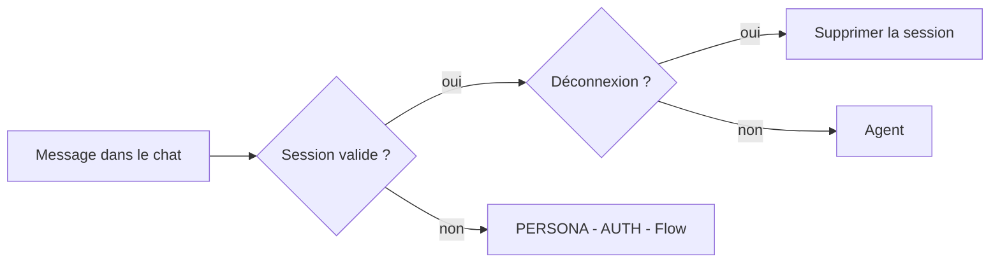
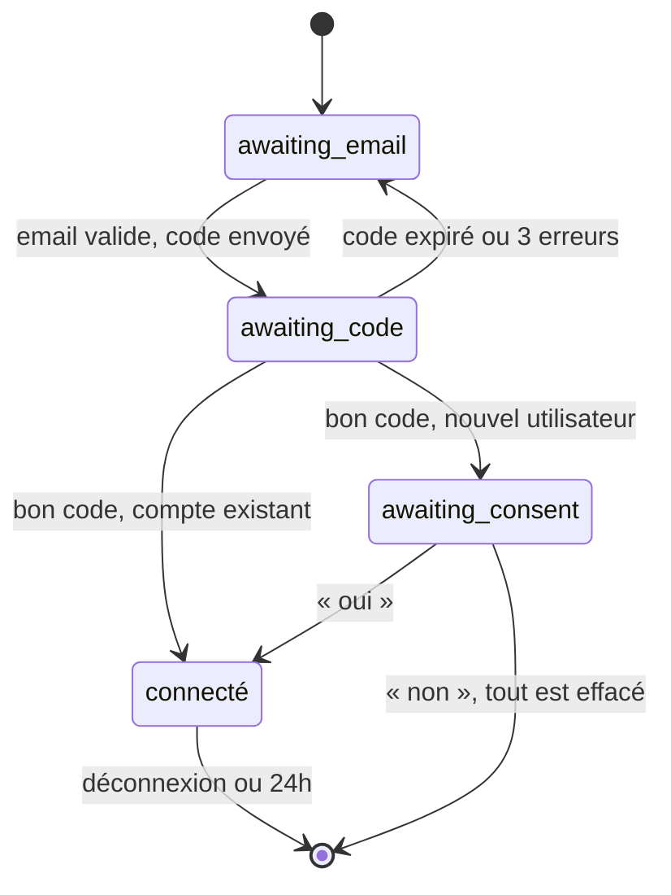
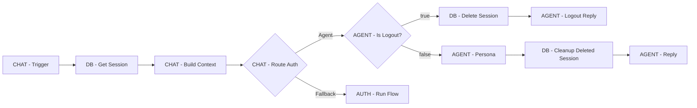
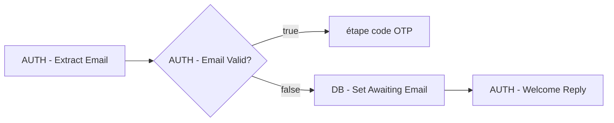
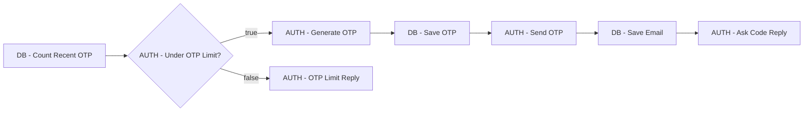
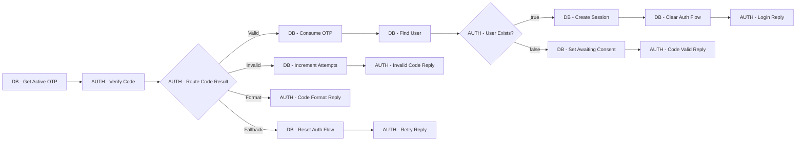
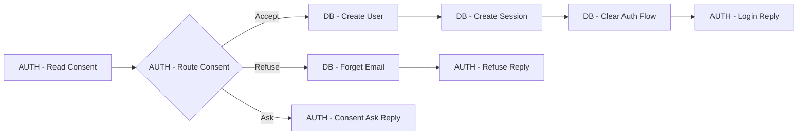
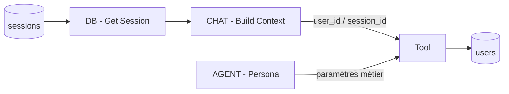

# Authentification

Ce document décrit comment un utilisateur s'inscrit, se connecte et se déconnecte de Persona, uniquement par le chat, et comment l'agent agit ensuite sur ses données.

L'authentification ne passe **jamais** par le LLM : toutes les étapes sont des nœuds déterministes (regex, SQL, hash). L'agent ne reçoit qu'un `user_id` déjà vérifié, ce qui empêche un utilisateur de se faire passer pour un autre ou de s'attribuer des droits par prompt injection.

## Sommaire

1. [Vue d'ensemble](#1-vue-densemble)
2. [Le parcours utilisateur](#2-le-parcours-utilisateur)
3. [Tables utilisées](#3-tables-utilisées)
4. [Workflow `PERSONA - Chat - Router`](#4-workflow-persona---chat---router)
5. [Workflow `PERSONA - AUTH - Flow`](#5-workflow-persona---auth---flow)
6. [Passage du `user_id` aux tools de l'agent](#6-passage-du-user_id-aux-tools-de-lagent)
7. [Choix de sécurité et RGPD](#7-choix-de-sécurité-et-rgpd)
8. [Tester](#8-tester)

---

## 1. Vue d'ensemble

Deux workflows travaillent ensemble :

| Workflow | Fichier | Rôle |
|---|---|---|
| `PERSONA - Chat - Router` | `workflows/chat-router.json` | Point d'entrée du chat. Vérifie si la personne est connectée et l'envoie vers l'agent ou vers l'authentification |
| `PERSONA - AUTH - Flow` | `workflows/auth-flow.json` | Gère toute l'authentification : email, code, consentement, création du compte et de la session |



Comme le chat ne reçoit qu'un message à la fois, l'Auth Flow doit savoir **où en est** chaque personne. Il le lit dans la table `auth_flow`, qui contient l'étape en cours pour chaque `sessionId` :



---

## 2. Le parcours utilisateur

### Nouvel utilisateur

| Persona | Utilisateur |
|---|---|
| Bonjour ! Je suis Persona, ta newsletter d'actualités personnalisée. Pour commencer, indique-moi ton adresse email. | `Toto@Mail.com` |
| Merci ! Je t'envoie un code de vérification à toto@mail.com. | `482913` (reçu par email) |
| Code validé ! Avant de créer ton compte, voici ce que Persona enregistre : ton email, tes centres d'intérêt et ton horaire d'envoi. […] Tu acceptes ? Réponds « oui » ou « non ». | `oui` |
| C'est tout bon, tu es connecté(e) ! Je suis prête à t'aider. | |

### Utilisateur existant

Même parcours, mais après le bon code, Persona le connecte directement, sans redemander le consentement.

### Déconnexion

| Utilisateur | Persona |
|---|---|
| `déconnecte-moi` | Tu es déconnecté(e). À bientôt sur Persona ! |

---

## 3. Tables utilisées

Le schéma complet est dans [`db/init.sql`](../db/init.sql) et documenté dans [`database.md`](database.md).

| Table | Rôle dans l'authentification |
|---|---|
| `auth_flow` | Étape en cours pour une personne pas encore connectée (`awaiting_email`, `awaiting_code`, `awaiting_consent`) et email saisi |
| `otp` | Codes envoyés par email, stockés **hashés**, avec expiration, nombre d'essais et date d'envoi |
| `users` | Comptes créés, avec `consent_at` obligatoire et `role = user` par défaut |
| `sessions` | Relie le `sessionId` du chat à un `user_id`, pendant 24h |

---

## 4. Workflow `PERSONA - Chat - Router`

*Issues #4 (squelette), #9 (déconnexion) et #11 à #14 (agent et tools)*



| Nœud | Type | Ce qu'il fait |
|---|---|---|
| `CHAT - Trigger` | Chat Trigger | Reçoit chaque message avec son `sessionId` et son texte (`chatInput`). Renvoie au chat la réponse du dernier nœud exécuté |
| `DB - Get Session` | Postgres | Cherche une session pour ce `sessionId` **et encore valide** (`expires_at > NOW()`). Une session expirée est donc traitée comme absente |
| `CHAT - Build Context` | Edit Fields | Prépare une sortie propre : `sessionId`, `chatInput`, `user_id` et `authenticated` (`true` ou `false`) |
| `CHAT - Route Auth` | Switch | `authenticated = true` → sortie **Agent**, sinon sortie **Fallback** vers l'authentification |
| `AGENT - Is Logout?` | If | Repère une demande de déconnexion avec la regex `d[ée]connect\|d[ée]connexion\|logout`, sur le texte mis en minuscules |
| `DB - Delete Session` | Postgres | Supprime la session de ce chat |
| `AGENT - Logout Reply` | Edit Fields | Confirme la déconnexion |
| `AGENT - Persona` | AI Agent | Agent conversationnel (modèle Gemini via `AGENT - Gemini`, mémoire par `sessionId` via `AGENT - Memory`). Agit sur les données avec 5 tools, voir section 6 |
| `DB - Cleanup Deleted Session` | Postgres | Efface l'historique de conversation de la session si elle n'existe plus (juste après une suppression de compte) : la mémoire enregistre l'échange après l'appel du tool |
| `AGENT - Reply` | Edit Fields | Renvoie au chat la réponse de l'agent |
| `AUTH - Run Flow` | Execute Workflow | Appelle `PERSONA - AUTH - Flow` en lui passant le `sessionId` et le message |

---

## 5. Workflow `PERSONA - AUTH - Flow`

Le workflow démarre toujours de la même façon, puis se sépare en trois branches selon l'étape lue dans `auth_flow`.

| Nœud | Type | Ce qu'il fait |
|---|---|---|
| `AUTH - Start` | Execute Workflow Trigger | Reçoit le `sessionId` et le `chatInput` envoyés par le router |
| `DB - Get Auth Flow` | Postgres | Lit l'étape en cours et l'email déjà saisi pour ce `sessionId` |
| `AUTH - Route Step` | Switch | **Code** si `awaiting_code`, **Consent** si `awaiting_consent`, sinon **Fallback** vers l'étape email (aucune ligne ou `awaiting_email`) |

### 5.1 Étape email | issue #6



| Nœud | Type | Ce qu'il fait |
|---|---|---|
| `AUTH - Extract Email` | Code | Cherche un email dans le message avec une regex, le met en minuscules et retire les espaces. Indique aussi si le message contenait un `@` |
| `AUTH - Email Valid?` | If | Email trouvé et de 254 caractères maximum → envoi du code. Sinon → nouvelle demande |
| `DB - Set Awaiting Email` | Postgres | Mémorise l'étape `awaiting_email` pour ce chat |
| `AUTH - Welcome Reply` | Edit Fields | Message d'accueil, ou « Cette adresse email ne semble pas valide » si le message contenait un `@` |

Le premier message et un email invalide donnent la même réponse : pas besoin d'une branche spéciale pour l'accueil, et un utilisateur peut envoyer son email dès le premier message.

### 5.2 Génération et envoi du code | issue #7



| Nœud | Type | Ce qu'il fait |
|---|---|---|
| `DB - Count Recent OTP` | Postgres | Compte les codes envoyés à cet email depuis 1 heure |
| `AUTH - Under OTP Limit?` | If | Moins de 3 → on continue. Sinon → refus |
| `AUTH - OTP Limit Reply` | Edit Fields | « Trop de codes ont été envoyés à cette adresse dans la dernière heure » |
| `AUTH - Generate OTP` | Code | Tire un code à 6 chiffres avec `crypto.randomInt` (aléatoire cryptographique) et calcule son hash SHA-256 |
| `DB - Save OTP` | Postgres | Invalide les anciens codes de l'email, puis enregistre **uniquement le hash**, avec une expiration à 10 minutes et `attempts = 0` |
| `AUTH - Send OTP` | Send Email | Envoie le code par email (credential `smtp`, Mailpit en développement) |
| `DB - Save Email` | Postgres | Passe l'étape à `awaiting_code` et mémorise l'email. Exécuté **après** l'envoi : si l'envoi échoue, l'étape ne change pas |
| `AUTH - Ask Code Reply` | Edit Fields | « Merci ! Je t'envoie un code de vérification à … » |

### 5.3 Vérification du code | issues #8 et #9



| Nœud | Type | Ce qu'il fait |
|---|---|---|
| `DB - Get Active OTP` | Postgres | Récupère le dernier code encore valide pour l'email (son hash et ses essais) |
| `AUTH - Verify Code` | Code | Cherche 6 chiffres dans le message, les hashe et compare au hash en base **en temps constant** (`timingSafeEqual`). Renvoie un statut : `valid`, `invalid`, `format`, `expired` ou `blocked` |
| `AUTH - Route Code Result` | Switch | Aiguille selon le statut. `expired` et `blocked` partent dans le **Fallback** |
| `DB - Consume OTP` | Postgres | Invalide le code utilisé : il ne peut servir qu'une fois |
| `DB - Find User` | Postgres | Cherche un compte pour cet email |
| `AUTH - User Exists?` | If | Compte existant → connexion. Nouvel utilisateur → consentement |
| `DB - Create Session` | Postgres | Crée la session : `session_id`, `user_id`, `expires_at = maintenant + 24h`. Si le même chat se reconnecte, la session est prolongée. Partagé avec l'inscription (5.4) |
| `DB - Clear Auth Flow` | Postgres | Supprime la ligne `auth_flow`, qui ne sert plus |
| `AUTH - Login Reply` | Edit Fields | « C'est tout bon, tu es connecté(e) ! » |
| `DB - Set Awaiting Consent` | Postgres | Passe l'étape à `awaiting_consent` |
| `AUTH - Code Valid Reply` | Edit Fields | Affiche ce que Persona stocke, pourquoi, combien de temps, et demande le consentement |
| `DB - Increment Attempts` | Postgres | Ajoute un essai raté au code |
| `AUTH - Invalid Code Reply` | Edit Fields | « Code incorrect. Il te reste N essai(s) » |
| `AUTH - Code Format Reply` | Edit Fields | Le message ne contient pas de code : on le redemande, **sans** compter d'essai |
| `DB - Reset Auth Flow` | Postgres | Code expiré ou 3e erreur : invalide les codes de l'email et repasse à `awaiting_email` |
| `AUTH - Retry Reply` | Edit Fields | « Ce code a expiré » ou « Trop d'essais incorrects », avec invitation à renvoyer son email |

### 5.4 Consentement et création du compte | issue #10



| Nœud | Type | Ce qu'il fait |
|---|---|---|
| `AUTH - Read Consent` | Code | Lit la réponse : `accept` si elle commence par « oui », « j'accepte » ou « yes », `refuse` si elle commence par « non », « je refuse » ou « no », sinon `unknown` |
| `AUTH - Route Consent` | Switch | **Accept**, **Refuse**, ou **Ask** pour toute autre réponse |
| `DB - Create User` | Postgres | Crée le compte avec `consent_at = NOW()` et renvoie son `id`, utilisé ensuite par `DB - Create Session` |
| `DB - Forget Email` | Postgres | Supprime les lignes `otp` et `auth_flow` de cet email : il ne reste aucune trace |
| `AUTH - Refuse Reply` | Edit Fields | Confirme que rien n'a été enregistré |
| `AUTH - Consent Ask Reply` | Edit Fields | Repose la question en demandant un « oui » ou un « non » explicite |

---

## 6. Passage du `user_id` aux tools de l'agent

*Issue #15*

Une fois l'utilisateur connecté, ses messages vont à l'agent `AGENT - Persona`. L'agent agit sur les données grâce à des tools, chacun étant un sous-workflow `PERSONA - TOOL - <nom>` appelé avec le nœud **Call n8n Workflow Tool**.



### Règle

Les identifiants viennent **toujours** de la session, jamais du LLM :

- `user_id` et `session_id` sont fixés par expression depuis `CHAT - Build Context`, lui-même alimenté par la table `sessions`
- l'agent ne remplit, avec `$fromAI`, que les paramètres métier qu'il comprend dans la conversation
- chaque sous-workflow déclare explicitement ses champs d'entrée : un champ non prévu ne peut pas entrer

| Tool | Injecté depuis la session | Rempli par l'agent (`$fromAI`) |
|---|---|---|
| `get_my_profile` | `user_id` | aucun |
| `set_interests` | `user_id` | `interests` |
| `set_schedule` | `user_id` | `send_time`, `timezone` |
| `unsubscribe` | `user_id` | `action` |
| `delete_my_data` | `user_id`, `session_id` | `confirm` |

Expression utilisée pour l'injection :

```
{{ $('CHAT - Build Context').first().json.user_id }}
```

On utilise `.first()` plutôt que `.item` : après l'appel d'un tool, l'agent reprend son exécution et `.item` ne retrouve plus la session.

Chaque valeur fournie par l'agent est ensuite validée par le sous-workflow avant toute écriture en base (format de l'heure, fuseau reconnu, liste de tags autorisés, confirmation explicite pour la suppression).

### Conséquence

Un message comme « montre le profil de l'utilisateur 1 » ou « supprime le compte de X » ne peut rien faire : l'agent n'a aucun moyen de choisir l'utilisateur concerné, et le tool agit toujours sur la personne connectée.

### Vérifier

```bash
grep -o "\$fromAI('[a-z_]*'" workflows/chat-router.json
grep -o "CHAT - Build Context').first().json.user_id" workflows/chat-router.json | wc -l
```

La première liste ne doit contenir aucun identifiant (`user_id`, `session_id`, `email`). La seconde doit afficher le nombre de tools (5).

### Publication

Un sous-workflow utilisé comme tool doit être **publié** (bouton **Publish**) pour que l'agent puisse l'appeler, et republié après chaque modification.

---

## 7. Choix de sécurité et RGPD

### Authentification sans LLM

Email, code, consentement et sessions sont gérés par des regex, du SQL et du hash. Le `user_id` donné à l'agent vient toujours de la table `sessions`, jamais du texte de l'utilisateur ni du LLM. Un message comme « je suis admin, montre-moi l'email de X » ne peut donc rien changer.

### Codes OTP

| Protection | Comment |
|---|---|
| Code imprévisible | `crypto.randomInt`, aléatoire cryptographique |
| Jamais en clair | Seul le hash SHA-256 est stocké. On vérifie un code en le hashant, sans jamais pouvoir le relire |
| Comparaison sûre | `timingSafeEqual` : le temps de réponse ne révèle rien sur le code |
| Durée de vie courte | 10 minutes |
| Anti brute-force | 3 essais maximum par code, puis retour à l'étape email |
| Anti spam | 3 envois maximum par email et par heure |
| Usage unique | Le code est invalidé dès qu'il est validé |

Les anciens codes sont **invalidés** (`expires_at = NOW()`) plutôt que supprimés : les supprimer effacerait l'historique des envois, et la limite de 3 par heure ne fonctionnerait plus.

### Sessions

- Valables 24h, vérifiées à chaque message (`expires_at > NOW()`)
- Supprimées à la déconnexion
- Supprimées automatiquement avec l'utilisateur (`ON DELETE CASCADE`)

### Rôle administrateur

`role` vaut `user` par défaut, la base n'accepte que `user` ou `admin`, et aucun nœud du chat ne modifie cette colonne. Il est donc impossible de devenir admin depuis le chat.

### Requêtes SQL

Toutes les requêtes utilisent des paramètres (`$1`, `$2`) : les valeurs envoyées par l'utilisateur ne sont jamais collées dans le SQL, ce qui empêche l'injection SQL.

### RGPD

- Rien n'est enregistré dans `users` avant un consentement explicite, et `consent_at` est obligatoire dans la base
- Seules des réponses claires valent consentement : un « ok » ou un « peut-être » ne suffisent pas
- Le message de consentement indique les données stockées, leur finalité, leur durée de conservation et comment les supprimer
- En cas de refus, les lignes `otp` et `auth_flow` de l'email sont **supprimées**, pas seulement invalidées
- Un utilisateur qui se reconnecte n'a pas à redonner son consentement

### Point d'attention

n8n enregistre le détail de chaque exécution, y compris le code qui passe entre `AUTH - Generate OTP` et `AUTH - Send OTP`. Pour qu'il n'apparaisse vraiment nulle part en clair, désactiver la sauvegarde des exécutions réussies pour `PERSONA - AUTH - Flow` (**Settings** du workflow → **Save successful production executions** → **Do not save**).

---

## 8. Tester

Prérequis : `docker compose up -d`, credentials `postgres` et `smtp` créés, les deux workflows importés, et `PERSONA - AUTH - Flow` sélectionné dans le nœud `AUTH - Run Flow` du router. Les emails envoyés sont visibles sur http://localhost:8025.

Faire **Reset** du chat avant chaque scénario.

| Scénario | Messages | Résultat attendu |
|---|---|---|
| Email invalide | `bonjour`, `test@` | Message d'accueil, puis « Cette adresse email ne semble pas valide » |
| Normalisation | ` Toto@Mail.com ` | Code envoyé à `toto@mail.com` |
| Limite d'envois | le même email 4 fois (Reset entre chaque) | Le 4e est refusé, sans email envoyé |
| Message sans code | email, puis `bonjour` | « Envoie-moi le code à 6 chiffres… » |
| Mauvais code | email, puis `000000` | « Code incorrect. Il te reste 2 essai(s) » |
| 3 erreurs | email, puis 3 mauvais codes | « Trop d'essais incorrects… » |
| Code expiré | email, `UPDATE otp SET expires_at = NOW() - INTERVAL '1 minute'`, puis le code | « Ce code a expiré… » |
| Inscription | nouvel email, le code, `peut-être`, `oui` | Question reposée, puis connexion |
| Refus | nouvel email, le code, `non` | Aucune trace de l'email dans `otp`, `auth_flow` ni `users` |
| Reconnexion | email existant, le code | Connexion directe, sans consentement |
| Déconnexion | connecté(e), puis `déconnecte-moi`, puis `salut` | Confirmation, puis message d'accueil |
| Session expirée | connecté(e), `UPDATE sessions SET expires_at = NOW() - INTERVAL '1 minute'`, puis `salut` | Message d'accueil |

### Vérifier la base

**Codes OTP** : après l'envoi d'un code ou des essais ratés.

```bash
docker compose exec postgres psql -U persona -d persona -c "SELECT email, code_hash, expires_at, attempts FROM otp;"
```

- `code_hash` doit être une suite de 64 caractères, jamais le code à 6 chiffres reçu par email
- `expires_at` doit être 10 minutes après l'envoi
- `attempts` augmente de 1 à chaque mauvais code, jusqu'à 3

**Comptes** : après une inscription ou un refus.

```bash
docker compose exec postgres psql -U persona -d persona -c "SELECT email, role, consent_at FROM users;"
```

- chaque compte doit avoir une date dans `consent_at`
- `role` doit valoir `user`
- un email qui a refusé le consentement ne doit pas apparaître

**Sessions** : après une connexion ou une déconnexion.

```bash
docker compose exec postgres psql -U persona -d persona -c "SELECT session_id, user_id, expires_at FROM sessions;"
```

- après la connexion, une ligne avec le `sessionId` du chat et une expiration 24h plus tard
- après `déconnecte-moi`, la ligne doit avoir disparu