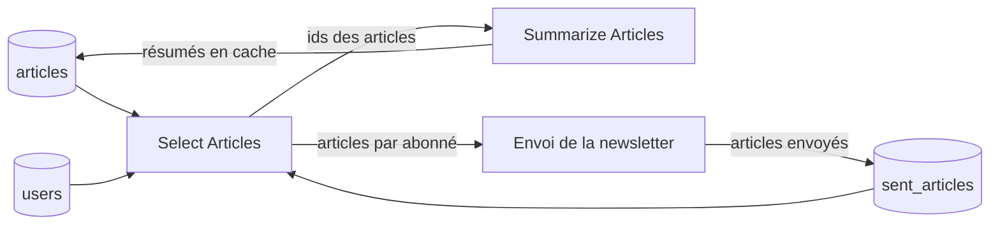
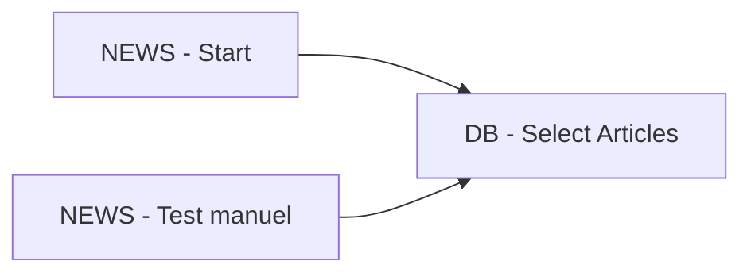
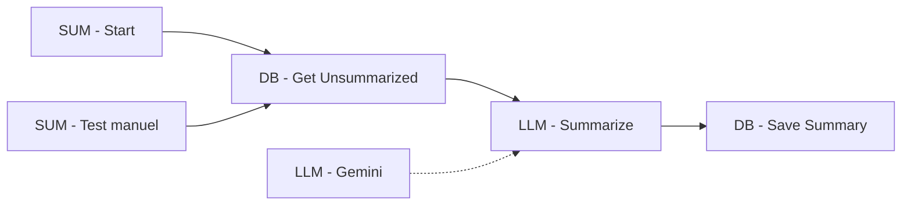
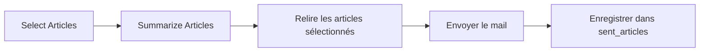

# Newsletter

Ce document décrit comment Persona choisit les articles de chaque abonné et les résume avant l'envoi de la newsletter.

La sélection ne passe **jamais** par le LLM : c'est une seule requête SQL, donc gratuite et prévisible. Le LLM ne sert qu'à résumer, et chaque article n'est résumé qu'**une seule fois** : un article déjà résumé ne consomme plus aucun token.

## Sommaire

1. [Vue d'ensemble](#1-vue-densemble)
2. [Tables utilisées](#2-tables-utilisées)
3. [Workflow `PERSONA - NEWSLETTER - Select Articles`](#3-workflow-persona---newsletter---select-articles)
4. [Workflow `PERSONA - NEWSLETTER - Summarize Articles`](#4-workflow-persona---newsletter---summarize-articles)
5. [Enchaînement avec l'envoi](#5-enchaînement-avec-lenvoi)
6. [Choix techniques et RGPD](#6-choix-techniques-et-rgpd)
7. [Tester](#7-tester)

---

## 1. Vue d'ensemble

Deux sous-workflows travaillent l'un après l'autre :

| Workflow | Fichier | Rôle |
|---|---|---|
| `PERSONA - NEWSLETTER - Select Articles` | `workflows/newsletter-select-articles.json` | Choisit pour chaque abonné actif les 5 articles les plus pertinents qu'il n'a jamais reçus |
| `PERSONA - NEWSLETTER - Summarize Articles` | `workflows/newsletter-summarize-articles.json` | Résume en 2 à 3 phrases les articles sélectionnés qui ne l'ont pas encore été |



Les articles sont récupérés, tagués et stockés en amont par le workflow `Persona - News sources` (voir [`sources.md`](sources.md) et [`tags.md`](tags.md)).

---

## 2. Tables utilisées

Le schéma complet est dans [`db/init.sql`](../db/init.sql) et documenté dans [`database.md`](database.md).

| Table | Rôle dans la newsletter |
|---|---|
| `users` | `interests` (tags choisis par l'abonné), `status` (`active` ou `unsubscribed`), `send_time` et `timezone` |
| `articles` | Articles avec leurs `tags`, leur `summary` et la colonne `summarized_at` qui sert de cache des résumés |
| `sent_articles` | Historique des envois : une ligne par couple (`user_id`, `article_id`) |

---

## 3. Workflow `PERSONA - NEWSLETTER - Select Articles`

*Issue #20*



| Nœud | Type | Ce qu'il fait |
|---|---|---|
| `NEWS - Start` | Execute Workflow Trigger | Reçoit un `user_id` optionnel. Vide : tous les abonnés actifs. Renseigné : un seul utilisateur (pratique pour l'envoi à l'heure de chacun) |
| `NEWS - Test (manuel)` | Manual Trigger | Lance la sélection pour tout le monde depuis l'éditeur |
| `DB - Select Articles` | Postgres | Une seule requête paramétrée qui applique toutes les règles ci-dessous |

### Règles de sélection

| Règle | Comment |
|---|---|
| Seulement les articles qui correspondent aux intérêts | `articles.tags && users.interests` (index GIN `articles_tags_idx`) |
| Jamais deux fois le même article | `NOT EXISTS` dans `sent_articles` pour ce `user_id` |
| 5 articles maximum par abonné | `LIMIT 5` dans un `LEFT JOIN LATERAL`, appliqué utilisateur par utilisateur |
| Les plus pertinents, puis les plus récents | `score` = nombre de tags en commun avec les intérêts, puis `published_at DESC` |
| Ignorer les désabonnés | `users.status = 'active'` |
| Ignorer les comptes sans intérêt | `cardinality(users.interests) > 0` |

### Sortie

Une ligne par abonné :

| Champ | Contenu |
|---|---|
| `user_id`, `email`, `pseudo` | Destinataire |
| `interests`, `send_time`, `timezone` | Ses réglages |
| `articles` | Liste JSON de 0 à 5 articles : `id`, `title`, `url`, `summary`, `source`, `tags`, `published_at`, `score` |
| `nb_articles` | Nombre d'articles sélectionnés |

Un abonné actif sans aucun article correspondant ressort avec `articles = []` et `nb_articles = 0` : l'envoi peut ainsi décider de ne rien lui envoyer.

---

## 4. Workflow `PERSONA - NEWSLETTER - Summarize Articles`

*Issue #21*



| Nœud | Type | Ce qu'il fait |
|---|---|---|
| `SUM - Start` | Execute Workflow Trigger | Reçoit `article_ids`, la liste des ids à résumer (`"45,49"` ou `[45, 49]`), en pratique ceux renvoyés par la sélection |
| `SUM - Test (manuel)` | Manual Trigger | Sans ids : résume jusqu'à 5 articles qui intéressent au moins un abonné actif |
| `DB - Get Unsummarized` | Postgres | Ne garde que les articles demandés dont `summarized_at IS NULL`. S'ils sont tous déjà résumés, renvoie 0 ligne et le workflow s'arrête là |
| `LLM - Summarize` | Basic LLM Chain | Envoie au modèle le titre, la source et l'extrait de l'article, avec le prompt ci-dessous |
| `LLM - Gemini` | Google Gemini Chat Model | Modèle `gemini-3.5-flash-lite`, température 0.2, credential `llm` |
| `DB - Save Summary` | Postgres | Écrit le résumé dans `summary` et la date dans `summarized_at`, puis renvoie `id`, `title`, `url`, `source`, `summary` |

### Le cache des résumés

`articles.summary` contient déjà l'extrait RSS dès l'insertion de l'article : cette colonne ne permet donc pas de savoir si le LLM est déjà passé. C'est le rôle de `articles.summarized_at` :

| `summarized_at` | Signification |
|---|---|
| `NULL` | Pas encore résumé. `summary` contient l'extrait RSS |
| une date | Déjà résumé. `summary` contient le résumé du LLM, l'article n'est plus jamais renvoyé au modèle |

`summarized_at` n'est rempli qu'**après** une réponse du LLM : si l'appel échoue, l'article reste à résumer et sera retenté au prochain passage.

Migration, présente dans `db/init.sql` et sans effet si la colonne existe déjà :

```sql
ALTER TABLE articles ADD COLUMN IF NOT EXISTS summarized_at TIMESTAMPTZ;
```

### Le prompt

```
Résume cet article d'actualité en 2 à 3 phrases courtes, en français, de façon neutre et factuelle.
N'invente aucune information : utilise uniquement le titre et l'extrait ci-dessous. Si l'extrait est vide ou trop court, reformule simplement le titre en une phrase.
Ne mets ni titre, ni lien, ni puces, ni guillemets : réponds uniquement par le résumé.

Titre : {{ $json.title }}
Source : {{ $json.source }}
Extrait : {{ $json.extract }}
```

Le lien vers la source n'est jamais modifié : il reste dans `articles.url` et doit être affiché avec chaque résumé dans le mail.

---

## 5. Enchaînement avec l'envoi

Le workflow d'envoi appelle les deux sous-workflows dans cet ordre :



1. **Sélectionner** les articles de l'abonné (`user_id`)
2. **Résumer** ceux qui ne le sont pas encore, en passant leurs ids
3. **Relire** les articles en base pour récupérer les résumés à jour
4. **Envoyer** le mail
5. **Enregistrer** chaque article envoyé, uniquement après un envoi réussi :

```sql
INSERT INTO sent_articles (user_id, article_id)
SELECT $1, unnest($2::int[])
ON CONFLICT DO NOTHING;
```

Sans cette dernière étape, la règle « jamais deux fois le même article » ne tient plus : la sélection ne peut exclure que ce qui est présent dans `sent_articles`.

---

## 6. Choix techniques et RGPD

### Sélection sans LLM

Croiser des intérêts et des tags est une comparaison exacte : SQL le fait mieux, plus vite et gratuitement. Le résultat est le même à chaque exécution, ce qui rend les tests fiables.

### Économie de tokens

| Choix | Effet |
|---|---|
| Sélection en SQL | 0 token |
| Résumé uniquement des articles sélectionnés | Les articles qui n'intéressent personne ne sont jamais résumés |
| Cache `summarized_at` | Un article est résumé une fois, quel que soit le nombre d'abonnés qui le reçoivent |
| Résumé à partir de l'extrait RSS | Prompt court, pas de page web entière envoyée au modèle |

### Une liste de tags commune

`articles.tags` et `users.interests` utilisent la même liste de 9 valeurs, définie dans [`tags.md`](tags.md). Le tool `set_interests` refuse toute autre valeur : sans cela, un intérêt ne correspondrait jamais à un tag.

### Requêtes SQL

Toutes les requêtes utilisent des paramètres (`$1`, `$2`) : aucune valeur n'est collée dans le SQL.

### RGPD

- Les résumés n'envoient au LLM que le **titre, la source et l'extrait** d'un article public : aucune donnée personnelle
- Un résumé est partagé par tous les abonnés : le LLM ne sait pas à qui il sera envoyé
- Les intérêts des utilisateurs ne quittent jamais la base : la sélection se fait en local
- Un utilisateur désabonné n'est jamais sélectionné, donc ne reçoit plus rien
- Les articles de plus de 7 jours sont purgés par `Persona - News sources`, et leurs lignes `sent_articles` partent avec eux (`ON DELETE CASCADE`)

### Point d'attention

Si l'extrait RSS est vide ou très court, le résumé se limite à une reformulation du titre. C'est voulu : le prompt interdit au modèle d'inventer du contenu.

---

## 7. Tester

Prérequis : `docker compose up -d`, credentials `postgres` et `llm` créés, les deux workflows importés, des articles en base (lancer `Persona - News sources`) et au moins deux comptes avec des intérêts différents.

### Sélection

Lancer `PERSONA - NEWSLETTER - Select Articles` avec **NEWS - Test (manuel)**.

| Scénario | Préparation | Résultat attendu |
|---|---|---|
| Intérêts respectés | Compte A : `tech`, `espace`. Compte B : `sante`, `environnement` | 5 articles par compte, tous avec au moins un tag de ses intérêts |
| Pertinence | Compte avec 2 intérêts | Les articles qui ont les 2 tags sortent en premier |
| Jamais deux fois | Insérer 2 articles de A dans `sent_articles`, relancer | Ces 2 articles disparaissent de la sélection de A, remplacés par les suivants |
| Désabonné | Passer B en `unsubscribed`, relancer | B n'apparaît plus dans le résultat |
| Sans intérêt | Compte avec `interests = {}` | Le compte n'apparaît pas |

### Résumés

| Scénario | Action | Résultat attendu |
|---|---|---|
| Premier résumé | Lancer **SUM - Test (manuel)** | Jusqu'à 5 articles résumés en 2 à 3 phrases, `url` inchangée |
| Cache | Rappeler le workflow avec les mêmes ids | 0 article sélectionné, `LLM - Summarize` ne s'exécute pas |

### Résultats obtenus (10/11/2026)

| Test | Résultat |
|---|---|
| Compte A (tech, espace) | OK : 5 articles tech et/ou espace, ceux avec les 2 tags en premier |
| Compte B (santé, environnement) | OK : 5 articles sante et/ou environnement |
| Articles 45 et 49 marqués comme envoyés à A | OK : disparus de sa sélection |
| B passé en `unsubscribed` | OK : absent du résultat |
| Résumé de 5 articles | OK : 2 à 3 phrases, `url` inchangée |
| Rappel avec `article_ids = "597,609,611"` (déjà résumés) | OK : 0 article, nœud LLM non exécuté |

### Vérifier la base

**Résumés** : après un passage du workflow de résumé.

```bash
docker compose exec postgres psql -U persona -d persona -P pager=off -c "SELECT count(*) AS total, count(summarized_at) AS resumes FROM articles;"
```

- `resumes` augmente après le premier passage
- relancer le résumé sur les mêmes articles ne change pas ce nombre

**Contenu d'un résumé** :

```bash
docker compose exec postgres psql -U persona -d persona -P pager=off -c "SELECT left(title, 50) AS title, summary, url FROM articles WHERE summarized_at IS NOT NULL LIMIT 3;"
```

- `summary` fait 2 à 3 phrases
- `url` pointe toujours vers la source

**Historique des envois** : après un envoi.

```bash
docker compose exec postgres psql -U persona -d persona -P pager=off -c "SELECT user_id, count(*) FROM sent_articles GROUP BY user_id;"
```

- une ligne par abonné servi
- relancer la sélection ne doit plus proposer ces articles à cet abonné